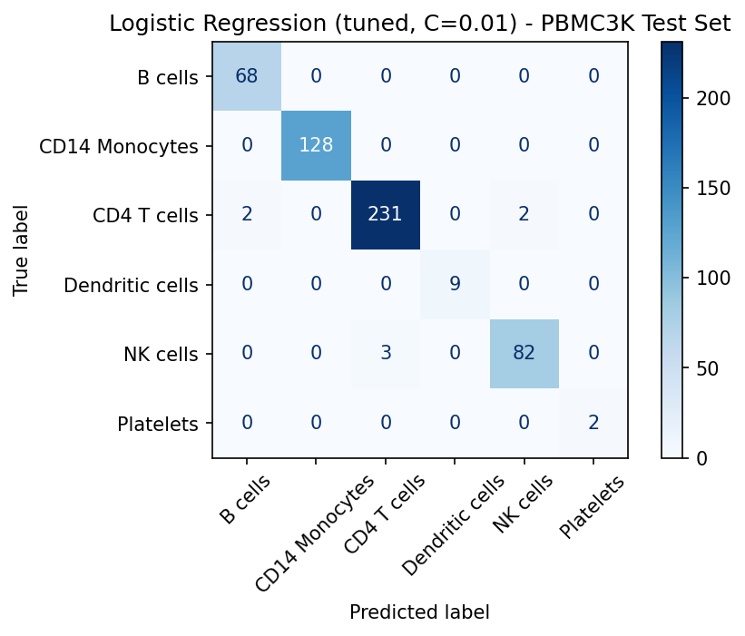
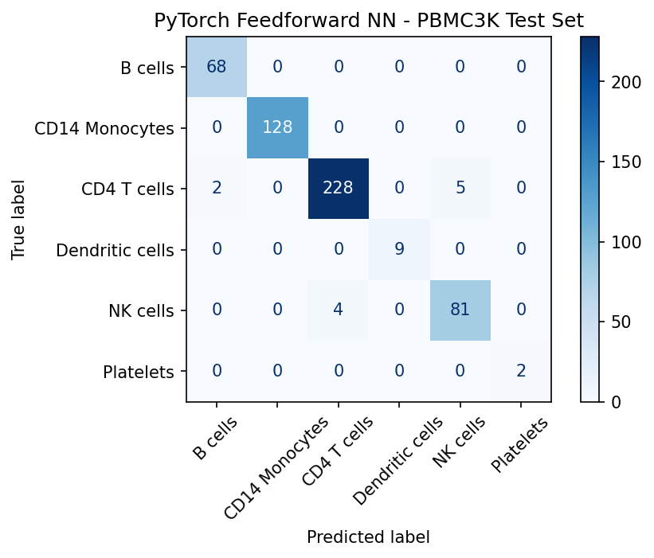
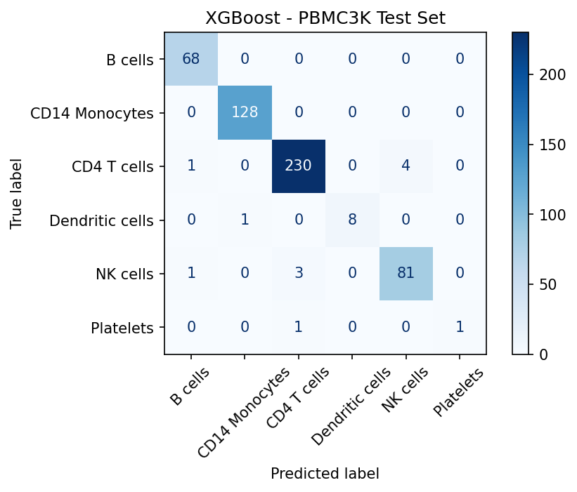
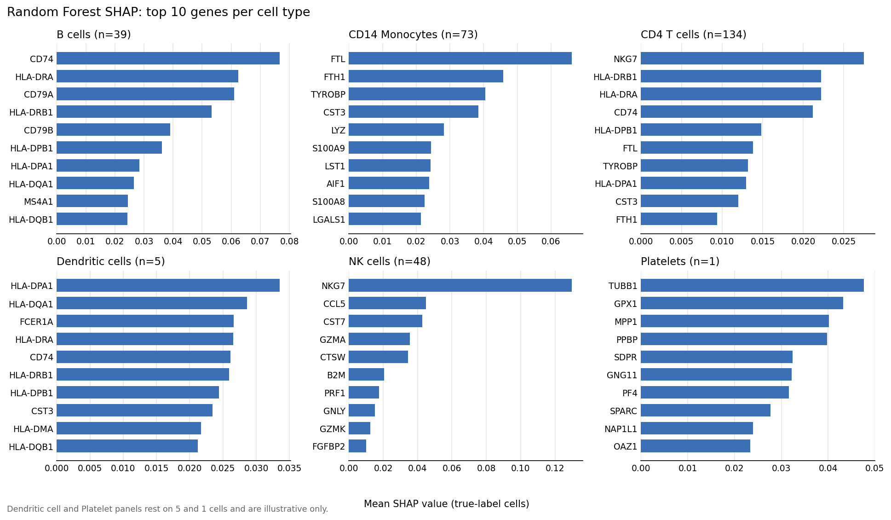
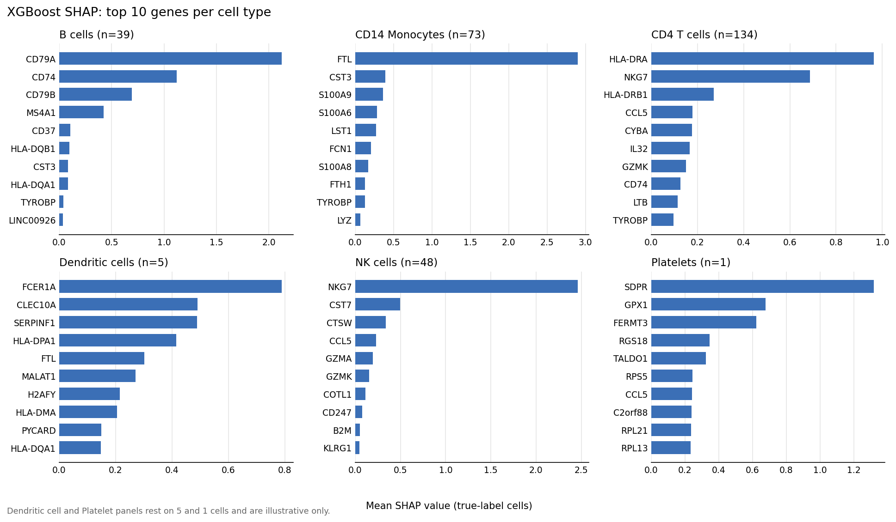

# ImmunoType

**ImmunoType** is a computational immunology research project
investigating whether machine-learning models can accurately classify
peripheral blood mononuclear cell (PBMC) immune cell types from
single-cell RNA sequencing (scRNA-seq) data and identify the genes that
contribute most strongly to those predictions.

## Key Results

- **Tuned Logistic Regression:** 98.7% accuracy and 0.990 macro F1 on
  527 held-out test cells.
- **Four models compared** (Logistic Regression, PyTorch NN, XGBoost,
  and Random Forest), each scored on the held-out test set exactly once.
- **Reproducible:** the full pipeline runs from a fresh clone in about
  4 minutes, and all 11 tests pass.

<p align="center">
  
</p>

## Core Research Question

> Can machine learning accurately classify PBMC immune cell types from
> scRNA-seq data, and which genes contribute most to model predictions?

## Project Goals

- Build a transparent and reproducible scRNA-seq preprocessing and
  annotation workflow.
- Compare Logistic Regression, Random Forest, XGBoost, and a PyTorch
  feedforward neural network for PBMC immune-cell classification.
- Evaluate performance with held-out testing, stratified
  cross-validation, confusion matrices, macro F1, weighted F1, and
  accuracy.
- Identify genes that drive predictions using model coefficients,
  feature importance, and SHAP-based interpretation.
- Validate the final approach on an independently annotated PBMC
  dataset.

## Current Status

**Phases 0–4 are complete. Phase 5 (Gene-Level Interpretation) is in
progress.**

## Phase Roadmap

| Phase | Name | Status | Description |
|---|---|---|---|
| 0 | Preparation | Complete | Repository, environment, project structure, reproducibility, and research workflow. |
| 1 | Dataset Exploration | Complete | Evaluate PBMC3K and PBMC68K Reduced for preprocessing, classification, and interpretation. |
| 2 | Preprocessing | Complete | QC, filtering, normalization, log transformation, HVGs, scaling/PCA decisions, and processed AnnData checkpoints. |
| 3 | Cell-Type Annotation | Complete | Leiden clustering, DE genes, CellMarker 3.0 reference comparison, scoring, validation, and final labels. |
| 4 | Supervised Machine Learning | Complete | Compare Logistic Regression, Random Forest, XGBoost, and PyTorch on a common PBMC3K feature space. |
| 5 | Gene-Level Interpretation | In progress | Interpret coefficients/feature importance and use SHAP to identify biologically meaningful predictive genes. |
| 6 | External Validation and Final Synthesis | Planned | Test on independently annotated PBMC data and consolidate final conclusions and deliverables. |

## Pipeline Notebooks

Each notebook reads the checkpoint written by the one before it.

| Notebook | Phase | Produces |
|---|---|---|
| `01_dataset_exploration.ipynb` | 1 | Inspection of PBMC3K (no files written beyond the raw download) |
| `02_dataset_validation.ipynb` | 1 | `data/raw/pbmc68k_reduced/pbmc68k_reduced.h5ad` |
| `03_preprocessing.ipynb` | 2 and 3 | `data/processed/pbmc3k_*.h5ad`, including `pbmc3k_clustered_annotated.h5ad` |
| `05_machine_learning.ipynb` | 4 | Trained models and training arrays in `models/` |
| `06_gene_interpretation.ipynb` | 5 | Coefficient, feature-importance, and SHAP gene rankings |

There is no notebook 04. Phase 3 (Leiden clustering, differential
expression, marker scoring, and final annotation) was done at the end
of `03_preprocessing.ipynb` (cells 47 to 71) rather than in a separate
notebook, and the numbering was kept so existing references in
`docs/research_log.md` stay valid.

## How to Reproduce

From a fresh clone (Python 3.12; on macOS, XGBoost needs OpenMP via
`brew install libomp`):

``` bash
python3.12 -m venv .venv
source .venv/bin/activate
pip install -r requirements-lock.txt
./reproduce.sh
python -m pytest tests/
```

`reproduce.sh` runs `scripts/download_data.py`, which downloads the raw
data to `data/raw/pbmc3k/pbmc3k_raw.h5ad` and verifies its SHA-256
checksum, then executes each notebook in order with
`jupyter nbconvert --execute`. On an Apple Silicon Mac it takes about
4 minutes (237 seconds measured from a fresh clone on 2026-11-24), plus
about 1.5 minutes for `pip install`. Every seed is fixed, and a fresh
clone reproduced every saved model and reported metric exactly.

Outputs:

- `data/processed/`: preprocessed and annotated AnnData checkpoints
- `models/`: tuned Logistic Regression, XGBoost, Random Forest, and
  PyTorch NN, plus the training arrays used by notebook 06
- `figures/`: confusion matrices for all four models
  (`confusion_matrix_*.png`) and per-class SHAP top-gene plots
  (`shap_random_forest_top_genes.png`, `shap_xgboost_top_genes.png`)

The tests in `tests/` run against those outputs (and skip if they have
not been generated yet). They check that QC keeps 2,633 of 2,700 cells
and 13,692 of 32,738 genes, that the train/test split is stratified with
2,106 training and 527 test cells, and that the saved tuned Logistic
Regression reproduces the reported test accuracy and F1 scores exactly.

## Data and Annotation

**Source:** 10x Genomics "3k PBMCs from a Healthy Donor" (Chromium
v1.1.0, hg19; 2,700 cells x 32,738 genes before QC), freely available
from
[10x Genomics](https://support.10xgenomics.com/single-cell-gene-expression/datasets/1.1.0/pbmc3k)
and downloaded here through Scanpy's `sc.datasets.pbmc3k()` (see How to
Reproduce). This is the same dataset used in the Seurat and Scanpy
PBMC3K tutorials.

The current supervised proof-of-concept dataset is the annotated PBMC3K
object:

- **Cells:** 2,633
- **ML features:** 2,000 highly variable genes
- **Cell types:** 6

| Cell type | Cells |
|---|---:|
| CD4 T cells | 1,175 |
| CD14 Monocytes | 639 |
| NK cells | 425 |
| B cells | 342 |
| Dendritic cells | 43 |
| Platelets | 9 |

Final Phase 3 cluster annotations:

``` python
cluster_annotations = {
    "0": "CD4 T cells",
    "1": "B cells",
    "2": "CD14 Monocytes",
    "3": "Platelets",
    "4": "NK cells",
    "5": "Dendritic cells",
}
```

The annotated AnnData checkpoint is:

``` text
data/processed/pbmc3k_clustered_annotated.h5ad
```

## Canonical Marker Annotation

Canonical PBMC marker panels were compiled from **CellMarker 3.0** and
organized into core and supporting markers. Cluster-specific
differential-expression genes were compared against these marker sets to
generate candidate annotations.

Candidate scores were treated as evidence rather than automatic ground
truth. Marker-expression dot plots were used to resolve ambiguous cases,
including the CD14 vs. FCGR3A monocyte distinction.

## Machine-Learning Results So Far

### Held-Out Test Set

The stratified split contains **2,106 training cells** and **527
held-out test cells**, an 80/20 train/test split reused identically
across all four models rather than a three-way split. Cross-validation
on the training partition serves the validation role for Logistic
Regression, Random Forest, and XGBoost; the PyTorch NN carves its own
train/validation split out of the training partition instead (see
Neural-Network Work below).

All cross-validation, Logistic Regression tuning, and NN training
decisions happen first, on training data only; each final model is then
scored on the held-out test set exactly once, in the final evaluation
section of `05_machine_learning.ipynb` (cells 30 to 38). This order was
put in place on 2026-11-24. Before that, default Logistic Regression,
XGBoost, and Random Forest were scored on the test set before
cross-validation and tuning, and Logistic Regression was scored twice
(default and tuned). Reordering changed no model and no reported
metric, because every step is seeded and deterministic; the only
change is that the Logistic Regression test result is now the tuned
model's, and the default model is reported by cross-validation only.

| Model | Accuracy | Macro F1 | Weighted F1 | Notebook cell |
|---|---:|---:|---:|---|
| Logistic Regression (tuned, C=0.01) | 0.9867 | 0.9902 | 0.9867 | nb05 c30 |
| Logistic Regression (default, C=1.0) | not scored | not scored | not scored | CV only, see below |
| PyTorch Feedforward NN | 0.9791 | 0.9849 | 0.9791 | nb05 c36 |
| XGBoost | 0.9791 | 0.9205 | 0.9788 | nb05 c32 |
| Random Forest | 0.9753 | 0.8964 | 0.9745 | nb05 c34 |

The default Logistic Regression is deliberately not scored on the test
set, so that each reported model touches it once. Its test score from
before the 2026-11-24 reorder (accuracy 0.9848, macro F1 0.9888) is
kept in `docs/research_log.md` for the record.

The tuned Logistic Regression misclassifies 7 of 527 test cells, all
among CD4 T cells, NK cells, and B cells:

| True \ Predicted | B cells | CD14 Mono | CD4 T | Dendritic | NK | Platelets |
|---|---:|---:|---:|---:|---:|---:|
| B cells | 68 | 0 | 0 | 0 | 0 | 0 |
| CD14 Monocytes | 0 | 128 | 0 | 0 | 0 | 0 |
| CD4 T cells | 2 | 0 | 231 | 0 | 2 | 0 |
| Dendritic cells | 0 | 0 | 0 | 9 | 0 | 0 |
| NK cells | 0 | 0 | 3 | 0 | 82 | 0 |
| Platelets | 0 | 0 | 0 | 0 | 0 | 2 |

Confusion matrices for the other three models on the same test set:

<table>
  <tr>
    <td></td>
    <td></td>
    <td></td>
  </tr>
  <tr>
    <td align="center">PyTorch NN</td>
    <td align="center">XGBoost</td>
    <td align="center">Random Forest</td>
  </tr>
</table>

### Five-Fold Cross-Validation on Training Data

| Model | Mean Accuracy | Mean Macro F1 | Mean Weighted F1 |
|---|---:|---:|---:|
| Logistic Regression (default, C=1.0) | 0.9796 | 0.9433 | 0.9798 |
| Logistic Regression (tuned, C=0.01) | not computed | 0.9748 | not computed |
| XGBoost | 0.9744 | 0.9299 | 0.9739 |
| Random Forest | 0.9763 | 0.9278 | 0.9752 |

The tuned row is GridSearchCV's best mean CV score, which was scored
on macro F1 only.

### Tuned Logistic Regression

GridSearchCV optimized **macro F1** over regularization strength using
training-only cross-validation.

- **Best `C`:** `0.01`
- **Best CV macro F1:** approximately `0.9748`
- **Final held-out accuracy:** `0.9867`
- **Final held-out macro F1:** `0.9902`
- **Final held-out weighted F1:** `0.9867`

Logistic Regression is the strongest model overall, with the PyTorch
neural network as the closest competitor (see the Held-Out Test Set
table above for the full four-model comparison).

## Neural-Network Work

The original training portion was split into:

- **NN training:** 1,684 cells x 2,000 genes
- **Validation:** 422 cells x 2,000 genes
- **Held-out test:** 527 cells x 2,000 genes

### Architecture

A feedforward network was trained on the same 2,000-HVG standardized
feature space used by the other three models:

- **Input:** 2,000 features
- **Hidden layers:** 2,000 → 256 → 64, each with BatchNorm, ReLU, and
  dropout (p=0.4)
- **Output:** 6 classes (`CrossEntropyLoss`, i.e. softmax)
- **Optimizer:** Adam, lr=1e-3, weight_decay=1e-4
- **Loss weighting:** inverse class frequency
  (`compute_class_weight("balanced")`), matching the
  `class_weight="balanced"` setting used for Logistic Regression and
  Random Forest (required given the severe class imbalance: 7
  Platelets and 34 Dendritic cells in the training set)
- **Batch size:** 64
- **Random seed:** 42

Architecture and training decisions used only the training/validation
split; the 527-cell held-out test set was evaluated once, at the end.

The two-hidden-layer design was a mid-implementation change from an
originally discussed single-hidden-layer network (2,000 → 128 → 6).
BatchNorm, dropout, and early stopping kept validation macro F1 (0.995)
and test macro F1 (0.985) close despite the added capacity, which is the
evidence against overfitting on the small training set, not the
architecture choice by itself. Output is raw logits: `CrossEntropyLoss`
applies softmax internally, so no separate `Softmax` layer is used.

### Results

Early stopping on validation macro F1 (patience=15, max 100 epochs)
stopped training at **epoch 29**, restoring the best-epoch weights.

- **Best validation macro F1:** 0.995
- **Held-out test accuracy:** 97.91%
- **Held-out test macro F1:** 0.985
- **Held-out test weighted F1:** 0.979

The class-weighted PyTorch NN outperformed XGBoost and Random Forest on
macro F1 (the metric most sensitive to the rare classes), suggesting its
weighted loss handled class imbalance more effectively than the
tree-based models' class weighting on this small, high-dimensional,
imbalanced dataset. Full per-class metrics and the training/validation
curves are in `docs/research_log.md`.

## Gene-Level Interpretation (SHAP)

Per-class SHAP attributions were computed for Random Forest and XGBoost
on a stratified 300-cell sample of the training set. Each panel shows
the genes with the largest mean SHAP value among cells whose true label
is that class (`06_gene_interpretation.ipynb`). FTL (CD14 Monocytes) and
NKG7 (NK cells) rank first in both models and in the Logistic
Regression coefficients; CD79A ranks first for B cells in XGBoost and
in the coefficients, while Random Forest ranks CD74 first. The
Dendritic cell (n=5) and Platelet (n=1) panels are illustrative only.





## Important Limitations

- The 2,000 highly variable genes were selected in
  `03_preprocessing.ipynb` on all 2,633 cells, before the train/test
  split in `05_machine_learning.ipynb`. Feature selection therefore saw
  the test cells, which can make test performance slightly optimistic.
  (Feature scaling, by contrast, is fit on training cells only.)
- The labels come from Leiden clustering run on the same cells and the
  same expression data the models learn from. Test accuracy therefore
  partly measures how well a classifier recovers that clustering, not
  agreement with an independent ground truth.
- Dendritic cell and Platelet SHAP results rest on 5 cells and 1 cell,
  respectively, in the 300-cell SHAP sample (and on 9 and 2 cells in
  the test set), so they are illustrative only.
- PBMC3K does not provide authoritative cell-level labels for the
  final six classes used here. The Phase 3 labels were derived from
  Leiden clusters, differential expression, canonical markers, and
  biological validation.
- Internal PBMC3K classification performance therefore measures the
  ability to reproduce these derived labels from the same broad
  expression domain.
- Platelets and dendritic cells are rare, so per-class performance
  estimates are unstable.
- Strong claims of generalization require an independently annotated
  external PBMC dataset.
- Feature harmonization and equivalent preprocessing will be required
  before external testing.
- The 2,000-HVG feature count was fixed early in Phase 2 and used
  unchanged through every downstream step. A planned comparison against
  alternative counts (e.g., 1,000 or 3,000) was never run.

## Background Reading

The following articles were supplied at the beginning of the project:

1. **Robust and interpretable prediction of gene markers and cell types
   from spatial transcriptomics data** - Nature Communications (2026)\
   https://www.nature.com/articles/s41467-026-68487-0

2. **Cell Reports Methods article, PII S2667-2375(23)00314-4**\
   https://www.cell.com/cell-reports-methods/fulltext/S2667-2375(23)00314-4#fig1

3. **xCell 2.0: robust algorithm for cell type proportion estimation
   predicts response to immune checkpoint blockade** - Genome Biology
   (2025)\
   https://pmc.ncbi.nlm.nih.gov/articles/PMC12492622/

## Technology

- Python
- Scanpy / AnnData
- NumPy / Pandas / SciPy
- scikit-learn
- XGBoost
- PyTorch
- SHAP
- Matplotlib
- Git / GitHub
- JupyterLab

## Reproducibility Principles

The project aims to record:

- dataset/version used
- cells and genes before/after major processing steps
- exact preprocessing/model parameters
- random seeds
- software versions
- output artifact paths
- scientific rationale for major decisions
- Git commits associated with milestones

## Current Next Step

PyTorch NN SHAP attribution is next, and is the last pass before Phase 5
(Gene-Level Interpretation) has a full conclusion. Across every method
run so far, the top CD4 T cell genes overlap NK markers such as NKG7,
CCL5, and GZMK, suggesting a cytotoxic subpopulation within the CD4 T
cell cluster that the current six-class taxonomy does not separate.
Method details, including the SHAP configuration bugs fixed along the
way, are in `docs/research_log.md`.
